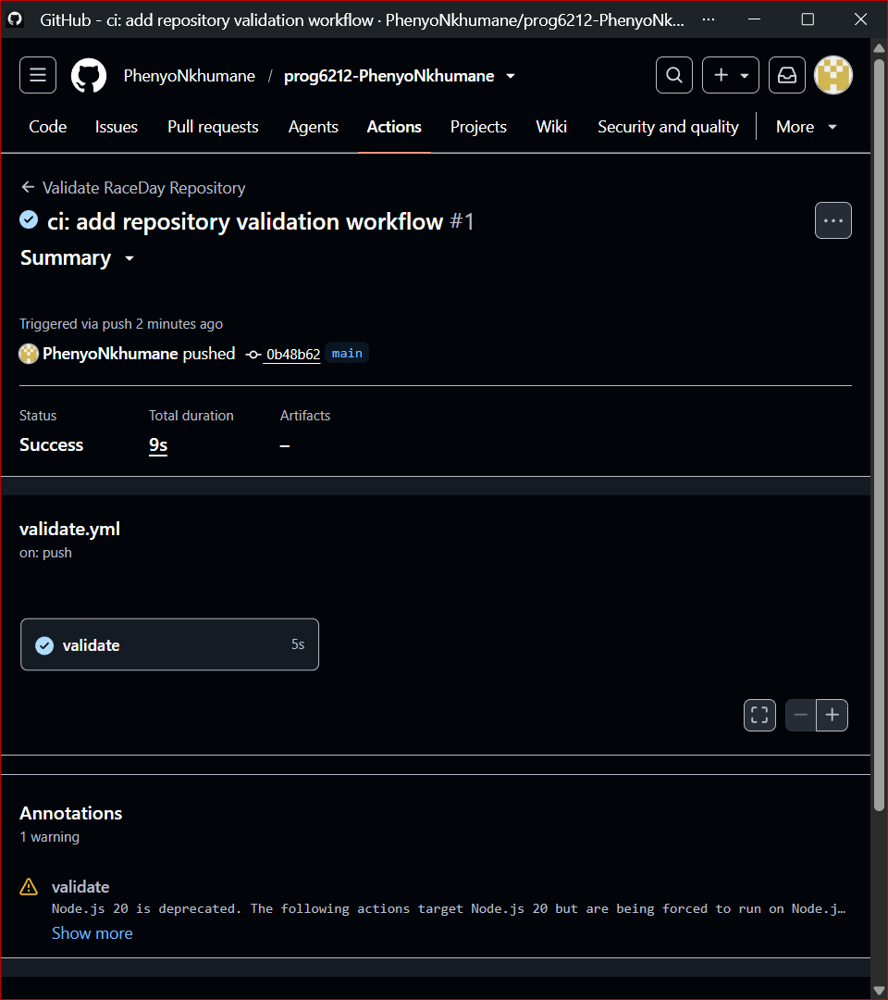

# RaceDay

## Project Overview

RaceDay is a race and event management system designed to support the organisation and participation of sporting events.

The system manages users, sporting disciplines, clubs, events, race categories, registrations, club memberships and race results.

## Database Design

The RaceDay database includes these entities:

- User
- Participant
- Organiser
- Event
- Category
- Discipline
- Registration
- Result
- Club
- ClubMembership

The database uses primary keys and foreign keys to maintain relationships between entities and includes constraints to support data integrity.

## Design Decisions and SQL/ERD Alignment

`docs/RaceDay.sql` and the current diagram source in `docs/ERD.md` describe the same entities, columns, and relationships. The diagram lists every table column; SQL constraints provide the additional allowed values and validation rules. The committed `docs/ERD.png` is an earlier visual export and does not reflect the latest schema, so use `docs/ERD.md` as the authoritative ERD until the PNG is regenerated.

Events store their advertised primary distance and event type (`Run`, `Walk`, or `Cycle`) to satisfy the brief. The Event `title` column is the event's name. Categories also store distance so one event can offer multiple race distances. A category is explicitly either distance-based or age-based; age categories use inclusive `min_age` and `max_age` bounds (for example, Under 20 or Senior). The event type and category discipline are both retained: event type describes the event, while discipline classifies the sport used for category and club membership records.

Registrations have a unique `(participant_id, category_id)` constraint. This prevents duplicate entries, but it also means a cancelled entry remains in the database and the participant cannot re-enrol in that same category. Changing that policy would require changing the uniqueness rule, for example to enforce uniqueness only for active registrations.

## User Roles

RaceDay supports exactly two account roles:

- Participant
- Organiser

A User has exactly one account subtype: Participant or Organiser. The subtype tables have one-to-one relationships with User. Event records reference Organiser, while registrations and club memberships reference Participant, so the database rejects cross-role use. Public self-registration creates Participant accounts only. An authorised administrator provisions Organiser accounts, and the organiser must change the temporary password on first login.

## Main Relationships

- An Organiser can create multiple Events.
- An Event can contain multiple Categories.
- A Category belongs to one Discipline.
- A Participant can have multiple Registrations.
- A Registration belongs to one Category.
- A Registration can have one Result.
- A Participant can belong to multiple Clubs through ClubMembership.
- A Participant can belong to only one Club per Discipline.
- A Club can have multiple ClubMembership records.

## Project Documentation

The `docs` folder contains:

- `ERD.md` — current entity relationship diagram source
- `ERD.png` — existing diagram image (legacy; see `ERD.md` for the updated account subtype design)
- `RaceDay.sql` — SQL database creation script
- `API-Endpoint-Plan.md` — planned REST API endpoints
- `Role-Based-Design.md` — account roles, permissions, and provisioning design

## Database Technology

- Microsoft SQL Server
- SQL Server Management Studio (SSMS)

## API

The ASP.NET Core API is in `RaceDay.Api` and follows REST principles. Sign-in uses **session cookies** (not JWT): `POST /api/auth/login` stores the user id and role in session. Protected actions use a custom `RequireRole` filter because `[Authorize(Roles=...)]` expects claims.

Public self-registration creates Participant accounts only. Organiser accounts are provisioned with `POST /api/admin/organisers` and the `X-Admin-Key` header (see `AdminProvisioningKey` in `appsettings.json`). The temporary password is returned once and must be changed at first login.

Run the database script in `docs/RaceDay.sql`, then:

```bash
dotnet run --project RaceDay.Api
```

Swagger is available in Development at `/swagger`.

## Tests

Unit tests live in the separate `RaceDay.Api.Tests` xUnit project. They use EF Core InMemory (`TestDbFactory`) and construct the real controllers. Session tests attach a `DefaultHttpContext` with a simple `ISession` implementation.

```bash
dotnet test
```

## GitHub Actions CI/CD

`.github/workflows/dotnet.yml` restores, builds, and runs the tests on .NET 10. A green tick only counts if that test step ran. `.github/workflows/validate.yml` still checks the required repository files.


