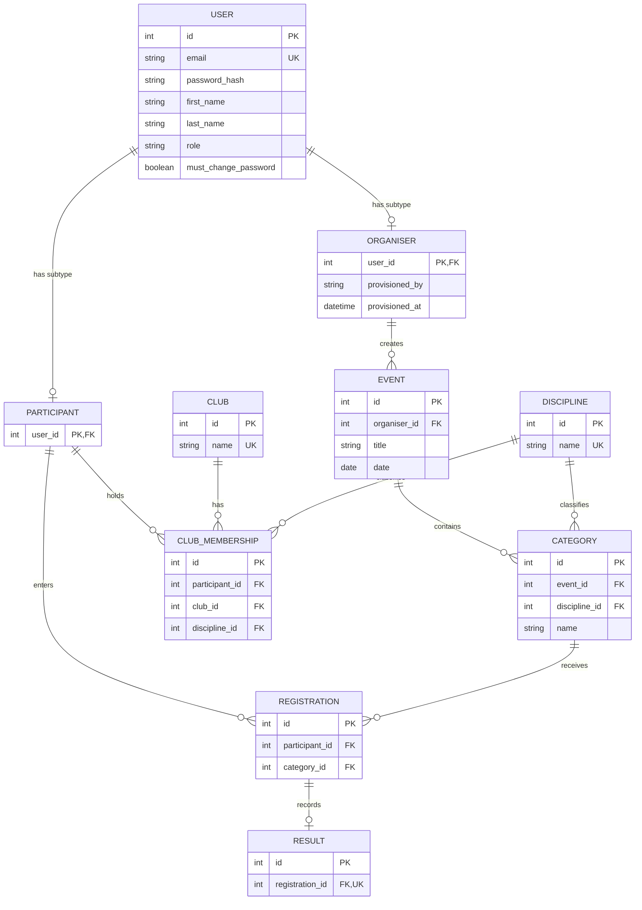

# RaceDay Entity Relationship Diagram

`User` stores shared login and identity details. Every account has one role and one matching subtype row. Public registration creates Participants only; Organisers are provisioned by an authorised administrator. Events reference Organiser, and Registrations and ClubMemberships reference Participant.

The database foreign keys bind event ownership to `Organiser` and participant activity to `Participant`. Constraints and subtype checks prevent a single account from occupying both roles.
